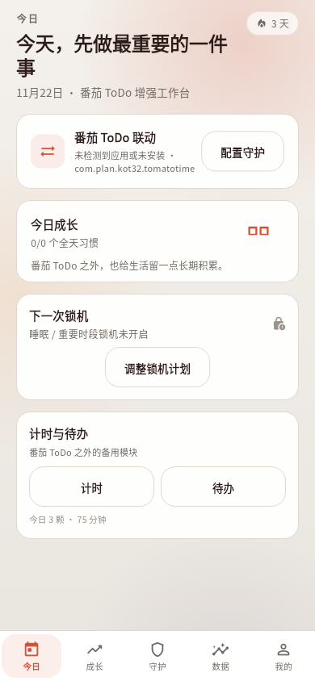
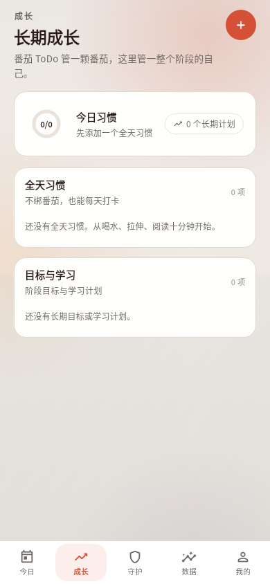
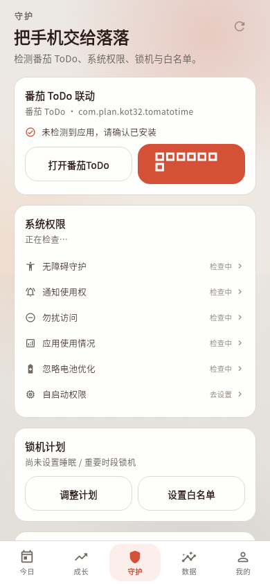
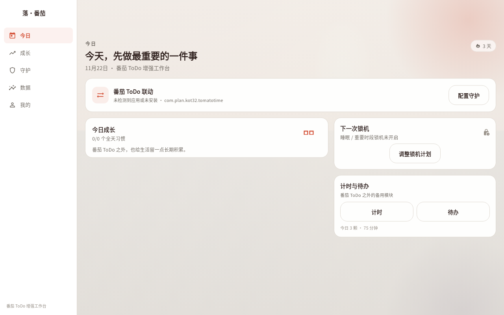

# 落·番茄

> 番茄 ToDo 的增强工作台：番茄 ToDo 负责一颗番茄，落·番茄负责一整个阶段的自己。

<p>
  
  
  
  <a href="https://github.com/starfall-miao/luo-fanqie/actions/workflows/ci.yml"></a>
</p>

落·番茄已从“另一个番茄钟”重建为 **`com.plan.kot32.tomatotime`（番茄 ToDo）的外挂增强层**：

- 番茄 ToDo 继续负责任务、番茄计时和它原有的习惯；
- 落·番茄补充：全天习惯、人生领域、学习计划、长期目标；
- 检测番茄 ToDo 并接管守护；
- 睡眠/重要时段锁机、白名单、每月退出次数；
- 通知 snooze、应用使用统计、自建文件服务器同步；
- 旧番茄计时与待办保留，但收进二级“计时与待办”入口。

<p align="center">
  
  
  
  <br />
  <sub>今日 · 成长 · 守护</sub>
</p>

<p align="center">
  
  <br />
  <sub>横屏与桌面使用侧边栏 + 内容区</sub>
</p>

## 新导航

| 模块 | 内容 |
| --- | --- |
| **今日** | 番茄 ToDo 联动状态、今日成长、下一次锁机、旧计时/待办入口 |
| **成长** | 全天习惯、人生领域、学习计划、长期目标与进度 |
| **守护** | 番茄 ToDo 检测、系统权限、锁机计划、白名单、数据导入入口 |
| **数据** | 专注、打断、使用情况的日/周/月/年折线图与全部应用明细 |
| **我的** | 外观、学霸守护、锁机、同步、安全与关于 |

## 与番茄 ToDo 的边界

番茄 ToDo **没有公开 API**。落·番茄不会假装可以自动双向同步：

- 能检测：是否安装、前台包名、通知、系统使用情况；
- 能守护：全屏提醒、锁定任务、勿扰、通知 snooze、白名单；
- 能导入：后续通过无障碍“显式抓取当前页面文字”，由用户确认后导入；
- **不能**：读取它的内部数据库、修改它的任务、替它开始计时、双向同步。

当前 Beta 已支持显式页面抓取：开启独立无障碍服务后，番茄ToDo 页面会出现「导入此页」按钮；抓取的文字回到 Guard 页预览、勾选后导入成长模块。不会持续读取屏幕。

## Android 系统守护

- 番茄 ToDo 包名：`com.plan.kot32.tomatotime`
- 可选系统权限：通知使用权、使用情况访问、无障碍、勿扰、电池优化/自启动
- 屏幕锁定：独立锁机页，每月 3 次提前打开机会
- 睡眠 / 重要时段锁机：每日开始时间 + 跨夜时长
- 通知 snooze：系统勿扰不可用时兜底，不读取通知内容
- 应用白名单：学习类应用建议，排除手机厂商自带包名

> iOS、桌面和 Web 没有上述系统级能力；它们保留同一套成长、数据、导入和同步界面，不提供假开关。

## 成长模块

- 全天习惯：不依赖番茄计时，每天可打卡，记录连续天数；
- 长期目标 / 学习计划：目标量、当前进度、所属人生领域；
- 未来会继续扩展人生领域、阶段复盘和学习档案。

## 数据与同步

- 数据页保留日/周/月/年折线图、打断原因、应用使用全部/单应用查询。
- 同步仍只支持用户自建的 WebDAV / OpenAlist / FTP，不接入第三方云。
- 本地数据优先；关闭同步时没有上传。
- 旧计时/待办数据仍保留在本机。

## 构建与测试

```bash
flutter pub get
flutter run
flutter test
```

要求 Flutter 3.47.9+、Dart 3.13+。

当前验证：**49 项测试通过**、`dart analyze` 0 issues、Android Kotlin 编译通过、六端 GitHub Actions Beta 构建成功。

## 下载

<https://github.com/starfall-miao/luo-fanqie/releases>

所有 Release 都是 Beta / Pre-release。

## 明确不做

- 不抓取 B 站受版权音频；
- 不抓取网络天气照片，天气背景使用 Open-Meteo 数据 + 本地绘制场景；
- 不做隐藏桌面图标、改壁纸、加固启动器、自动防关闭、防卸载；
- 不做未经用户点击的持续屏幕读取和数据库破解。

<sub>当前版本：2.1.0 · Beta · 番茄 ToDo 增强工作台</sub>
