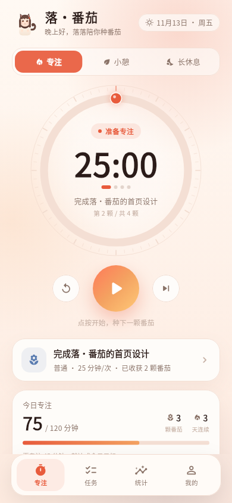
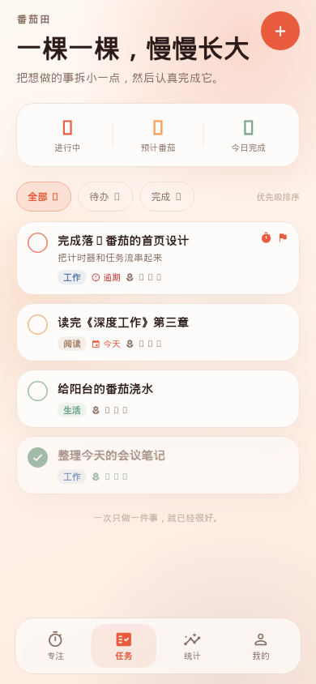
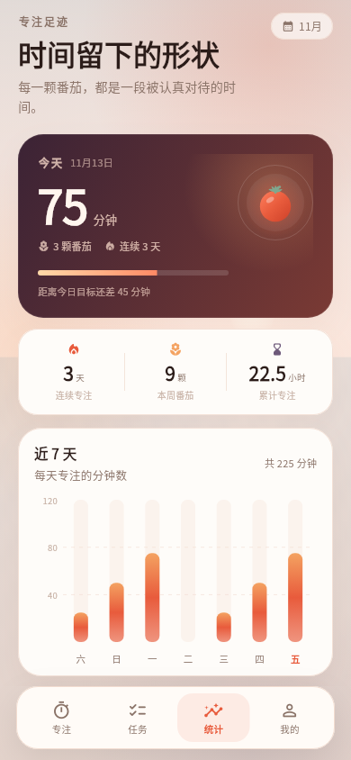
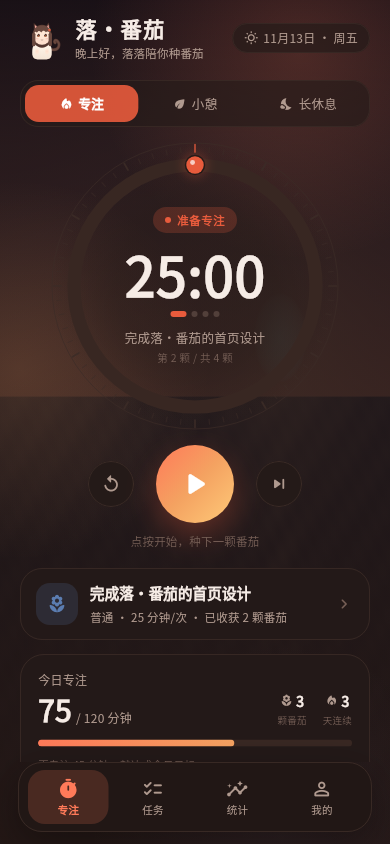
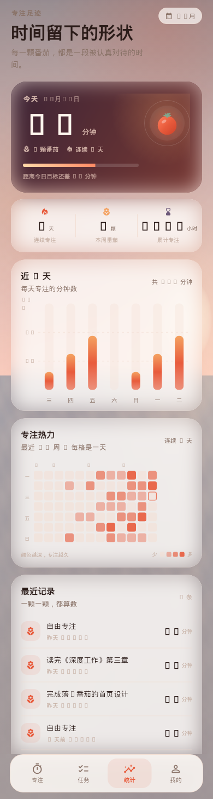
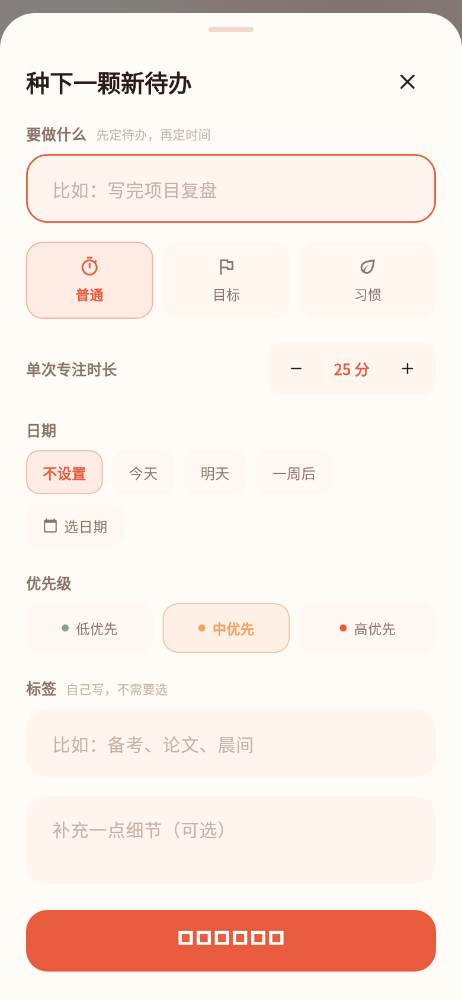

# 落·番茄

> 把时间种成番茄，也把注意力还给自己。

<p>
  
  
  <a href="https://github.com/starfall-miao/luo-fanqie/actions/workflows/ci.yml"></a>
  <a href="https://github.com/starfall-miao/luo-fanqie/releases"></a>
</p>

落·番茄是一款用 Flutter 编写的专注、任务与自律应用。它把「番茄钟、待办任务、专注统计、跨设备同步」放在同一条时间线上：选一颗任务，专注一颗番茄，让每一段被认真对待的时间都有迹可循。

界面以黄昏海面为底，用落日、暖雾与毛玻璃卡片营造沉浸感；功能上坚持**本地优先**，同步是可选的，不登录也能完整使用。

> 这是一个独立的个人项目。设计灵感来自番茄工作法与番茄 ToDo 类工具，但界面、图标与代码均为本项目原创，不包含其素材。

<p align="center">
  
  
  
</p>

<p align="center">
  
  
  
</p>

---

## 下载 Beta

- **GitHub Releases**：<https://github.com/starfall-miao/luo-fanqie/releases>
- 所有 Release 都标记为 **Pre-release / Beta**，标签统一使用 `v*-beta.*`。
- 同一份提交会由 GitHub Actions 构建多端产物，每个文件都附带 `.sha256`。

| 平台 | 产物 | 说明 |
| --- | --- | --- |
| Android | `*-android-universal.apk` | Android 7.0+（API 24），arm64 / armv7 / x86_64，release keystore 签名 |
| Web | `*-web.zip` | 静态站点，解压后用任意静态服务器托管 |
| iOS | `*-ios-unsigned.ipa` | 未签名产物，需要用 AltStore / Sideloadly 等自行重签 |
| macOS | `*-macos.zip` | 未签名的 `.app`；首次打开可能需要右键打开或移除 quarantine |
| Windows | `*-windows.zip` | 解压后运行 `luo_fanqie_app.exe` |
| Linux | `*-linux-x64.tar.gz` | 需要 GTK 3 运行环境，解压后运行 `luo_fanqie_app` |

> 目前只有 Android 与 Web 端经过重点测试；iOS / 桌面端是 Beta 构建，尚未做开发者签名或商店分发。因为项目仍处于 Beta，数据格式和交互可能继续调整；Android 升级请使用后续同签名版本覆盖安装，跨签名需要先卸载。

## 现在已经有的

### 沉浸式专注

- 25 / 5 / 15 分钟经典节奏，所有时长、长休息间隔与每日目标可调。
- 基于结束时间计时，切后台、锁屏或设备休眠后回到前台会自动校准。
- 计时快照保存在本地，冷启动可以恢复正在进行的番茄；如果已经超时，会自动补记。
- 完成专注后写入会话记录，可以选择关联任务并自动累计该任务的番茄数。
- Android 端通过原生 `AlarmManager` 发送系统通知：锁屏、切后台或进程被回收后也能收到提醒。
- 支持自动开始休息 / 自动开始下一颗、系统通知、声音与震动开关。

### 任务与专注闭环

- 标题、备注、预计番茄数、优先级、分类标签、截止日期。
- 未完成优先 → 高优先级优先 → 截止日期近优先的智能排序。
- 全部 / 待办 / 完成三种视图，左滑删除可撤销。
- 任务卡片支持**一键开始专注**：自动切换回专注页并启动番茄。
- 逾期、番茄进度、当前专注任务都有明确的视觉反馈。

### 专注统计

- 今日专注分钟、完成番茄、连续天数与每日目标进度。
- 近 7 天柱状图、近 12 周热力图。
- 最近的专注记录与本周、累计数据。

### 跨设备同步（GitHub Gist）

落·番茄不依赖自建服务器，使用 GitHub Gist 作为可选的同步中转：

1. 在 GitHub 创建一个只勾选 **Gists** 读写权限的 fine-grained token。
2. 打开 设置 → 跨设备同步，填入 Token，打开「自动同步」。
3. 首次同步会自动创建一个**私密 Gist**；另一台设备登录同一 GitHub 账号并填入 Token 即可自动找到它。
4. 同步地址、Token 与 Gist ID 只保存在本机，不会提交到仓库。

合并策略：

- 任务：按任务最后修改时间取较新版本；删除使用 90 天删除墓碑，避免删除被旧设备复活。
- 专注记录：按会话 id 求并集，不覆盖历史。
- 设置、主题、计时器状态不参与同步，保持每台设备独立。
- 这是「最后写入优先」的轻量同步，不是实时协作；同一秒内的并发修改以较新时间戳为准。

### 外观与交互

- 黄昏海面背景 + 毛玻璃卡片 + 暮色番茄配色。
- 跟随系统 / 浅色 / 深色。
- 手机底部胶囊导航，宽屏（≥ 980dp）自动切换为侧边导航。
- 无账号、无广告、无第三方统计 SDK；不联网也能完整使用。

---

## 快速开始

要求：Flutter **3.47.9+**、Dart 3.13+。

```bash
flutter pub get
flutter run -d chrome    # Web
flutter run              # Android / iOS 设备
flutter run -d macos     # macOS
flutter run -d windows   # Windows
flutter run -d linux     # Linux
```

### Android 构建（国内镜像）

本工程已配置国内镜像：

- Gradle distribution：腾讯云镜像
- Maven：阿里云 google / gradle-plugin / public 优先，官方仓库兜底
- Flutter 构建产物：`storage.flutter-io.cn`
- Pub：`pub.flutter-io.cn`

```bash
export LANG=C.UTF-8 LC_ALL=C.UTF-8       # 中文工程路径 + Java 必需
export JAVA_HOME=/usr/lib/jvm/java-17-openjdk-amd64
export ANDROID_HOME="$HOME/android-sdk"
export ANDROID_SDK_ROOT="$ANDROID_HOME"
export FLUTTER_STORAGE_BASE_URL=https://storage.flutter-io.cn
export PUB_HOSTED_URL=https://pub.flutter-io.cn

flutter build apk --release
```

本机已验证的 SDK 组合：OpenJDK 17、Android SDK Platform 36 / 35、Build-Tools 36.0.0、NDK 28.2.13676358（r28c）、CMake 3.22.1。

### 发布签名

- 本地开发：`android/key.properties` + `android/app/luo-fanqie-release.jks`
- GitHub Actions：keystore、密码和 alias 存储为仓库 Secrets
- 两者已加入 `.gitignore`，请不要提交签名文件
- **请单独备份 keystore**；丢失后将无法覆盖升级已安装的正式包

---

## 测试与 CI

```bash
flutter test          # 39 项单元 / 组件测试（截图测试默认跳过）
dart analyze
```

- `CI` workflow 在 push / PR 时自动执行 analyze 与 test。
- `Beta Release` workflow 支持手动触发或推送 `v*-beta.*` 标签，会并行构建：
  - Android 签名 APK + Web 静态包
  - iOS 未签名 IPA + macOS 未签名 `.app`
  - Windows ZIP + Linux x64 tar.gz
  - 汇总 SHA-256，创建 **Pre-release** GitHub Release（带 Beta 标识）
- 截图生成：

```bash
flutter test test/screenshots_test.dart \
  --update-goldens --dart-define=RUN_GOLDENS=true
```

当前覆盖：任务 CRUD / 排序 / 墓碑、设置持久化、统计聚合、番茄钟状态机、通知编排、深度合并、Gist 客户端、同步控制器、页面导航、小屏 / 宽屏布局与一键专注。

---

## 项目结构

```
lib/
├── main.dart                     # 控制器组装、Provider、生命周期
├── app.dart                      # MaterialApp、主题、中文本地化
├── core/
│   ├── notifications/            # Android 原生通知桥接
│   ├── storage/                  # KeyValueStorage / SharedPreferences
│   ├── theme/                    # 配色、毛玻璃表面、字体
│   └── utils/                    # 日期与 ID
├── features/
│   ├── home/                     # 导航壳、任务一键专注、生命周期
│   ├── focus/                    # 专注页、番茄表盘、任务选择器
│   ├── tasks/                    # 任务、删除墓碑、编辑面板
│   ├── stats/                    # 会话、周图表、热力图
│   ├── sync/                     # Gist 客户端、同步控制器、配置面板
│   ├── settings/                 # 设置与同步入口
│   └── timer/                    # 番茄钟状态机、阶段视觉、通知调度
└── shared/widgets/               # 背景、玻璃卡片、品牌番茄

android/ · ios/ · macos/ · windows/ · linux/ · web/   # 平台工程
```

技术栈：Flutter / Material 3、ChangeNotifier + provider、shared_preferences、fl_chart、http、CustomPainter、Android AlarmManager（Kotlin）。

---

## 数据与隐私

- 默认全部数据保存在本机；同步关闭时没有任何网络请求。
- 开启同步后只与 GitHub API 通信，数据写入你自己的私密 Gist。
- GitHub Token 与同步配置以应用偏好设置形式保存在本机（依赖系统应用沙盒，不是独立加密保险箱）；请不要在共享设备上长期保留 Token。
- 私密 Gist 不等于端到端加密：GitHub 服务端可以读取其中的数据。请勿把不愿意交给第三方的敏感内容放进任务或备注。
- 设置页提供清除已完成任务、清空专注记录与断开同步入口。
- 卸载应用会删除本地数据；云端 Gist 需要到 GitHub 手动删除。

## 已知边界与 Roadmap

当前版本是 Beta，以下能力仍在计划中：

- [x] 番茄钟、任务、统计、Android 系统通知
- [x] GitHub Gist 跨设备同步
- [x] 黄昏海面 + 毛玻璃视觉、任务一键开始
- [ ] 应用内「锁机 / 学霸模式」：严格计时、离开页面提醒、免打扰引导
- [ ] 白噪音与背景音（雨声、海浪、咖啡馆等）
- [ ] 任务目标时长 / 今日进度百分比
- [ ] iOS / 桌面端本地通知
- [ ] 更多主题与小组件

关于「强制防打扰」：阻止其他 App、拦截全部通知、隐藏桌面图标、防卸载这类能力依赖 Android 辅助功能、设备管理员或定制 ROM，且与 Google Play 政策、用户安全和隐私存在冲突，本项目不会以「恶意防关闭」的方式实现。后续会优先做**应用内严格模式 + 免打扰引导**这种透明、可退出的方案。

---

## 致谢

- [fl_chart](https://github.com/imaNNeo/fl_chart) 提供图表
- [provider](https://pub.dev/packages/provider)、[shared_preferences](https://pub.dev/packages/shared_preferences)、[http](https://pub.dev/packages/http)
- 所有界面插画、图标与番茄 Logo 由本项目自行绘制

如果这颗番茄对你有一点用，欢迎点一个 Star，或者去种下今天的第一个 25 分钟。

<sub>当前版本：1.2.0 · Beta</sub>
