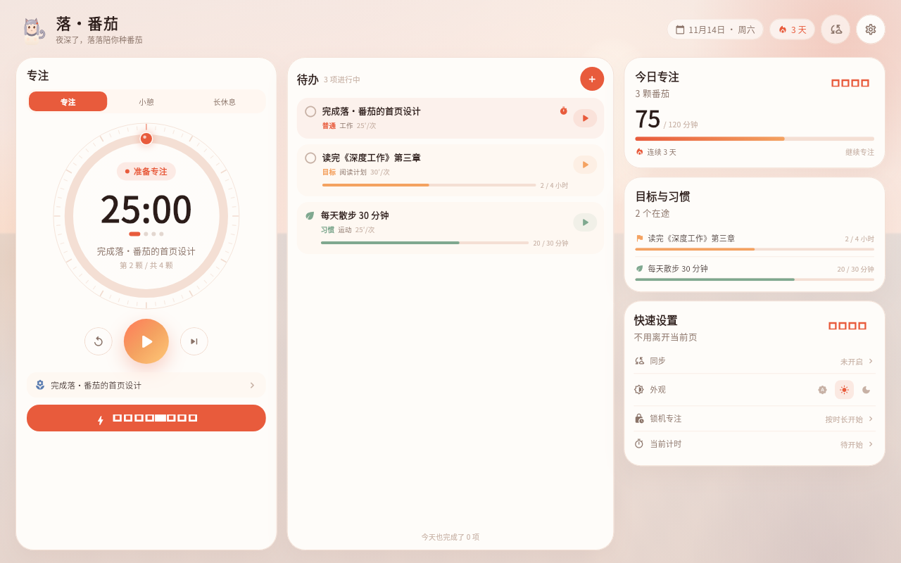
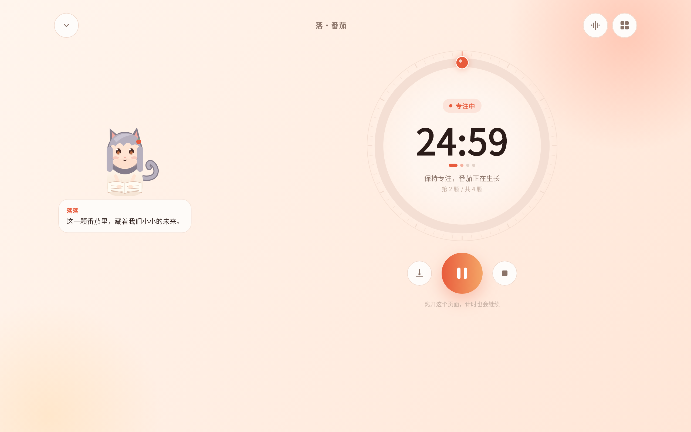

# 落·番茄

> 先定待办，再定时间。把注意力还给当下。

<p>
  
  
  
  <a href="https://github.com/starfall-miao/luo-fanqie/actions/workflows/ci.yml"></a>
  <a href="https://github.com/starfall-miao/luo-fanqie/releases"></a>
</p>

落·番茄是一个**任务驱动**的专注与自律 App：先写下想做的事，再决定以什么方式专注。

- **普通番茄**：一颗番茄一个任务，简单直接。
- **定目标**：在目标日期前累计完成指定量，支持分钟 / 小时 / 次数 / 自定义单位。
- **养习惯**：每天、每周选几天、每月选几天，或设置每周 / 每月完成量。
- 每种待办都可以单独设定单次专注时长，支持自定义标签和一键开始。
- 横屏 / 平板 / 电脑端取消标签栏，一页卡片仪表盘展示全部核心内容，并可打开完整统计。
- 猫娘看板娘「落落」陪你专注，会眨眼、抱着书，也会说一些温柔的话。
- 学霸模式拆成置顶提醒、锁定任务、静音通知、白名单、每月 3 次退出机会等可配置项。
- 手动锁机：选择 25–120 分钟，进入严格专注；自动定时锁机仍在 Roadmap。
- 统计新增日/周/月/年表和打断原因；Android 可选应用使用情况统计。
- 毛玻璃可关闭；默认使用轻量纯色卡片，低端机更流畅。
- 开始专注后进入沉浸式会话页：柔和背景、激励文案、最小化、工具与学霸模式。
- 可选 **用户自建文件服务器同步**（WebDAV / OpenAlist / FTP）；Android 原生通知；六端 Beta 自动构建。

> 这是一个独立的个人项目，设计灵感来自番茄工作法与番茄 ToDo 类工具，但界面、代码与图标归属本项目；不包含其素材。

<p align="center">
  
  <br />
  <sub>1280 × 800 横屏：取消标签栏，一页展示专注、待办、目标习惯和快捷设置</sub>
</p>

<p align="center">
  
  
  
  <br />
  <sub>竖屏专注 · 等待办列表 · 沉浸式会话页</sub>
</p>

---

## 下载 Beta

- **最新 Release**：<https://github.com/starfall-miao/luo-fanqie/releases>
- 所有 Release 都是 **Pre-release / Beta**，标签为 `v*-beta.*`。
- 同一条提交由 GitHub Actions 构建 Android / iOS / macOS / Windows / Linux / Web 六端产物，并附带 `.sha256`。

| 平台 | 产物 | 说明 |
| --- | --- | --- |
| Android | `*-android-universal.apk` | Android 7.0+，release keystore 签名，arm64 / armv7 / x86_64 |
| Web | `*-web.zip` | 静态站点，解压后用任意静态服务器托管 |
| iOS | `*-ios-unsigned.ipa` | 未签名，需要用自己的证书或 AltStore / Sideloadly 重签 |
| macOS | `*-macos.zip` | 未签名 `.app`，首次打开可能需要在系统设置中允许 |
| Windows | `*-windows.zip` | 解压后运行 `luo_fanqie_app.exe` |
| Linux | `*-linux-x64.tar.gz` | 需要 GTK 3 运行环境，解压后运行 `luo_fanqie_app` |

> 目前重点验证 Android 与 Web；iOS / 桌面为 Beta 构建，尚未做商店级签名。Android 升级请使用后续同签名版本覆盖安装，跨签名需要先卸载。

---

## 三种待办

| 类型 | 你设定什么 | 卡片展示 |
| --- | --- | --- |
| 普通番茄 | 单次专注时长、标签、优先级 | 已完成番茄数、单次时长 |
| 定目标 | 目标日期、目标总量、单位、单次时长 | 进度条 + 已完成 / 目标 |
| 养习惯 | 每天 / 每周选天 / 每月选天 / 每周或每月完成量、单次时长 | 今日或本周进度 + 习惯节奏 |

**自定义标签**：标签输入框直接写，例如「备考」「论文」「晨间」，不需要从预设选项里挑；颜色由标签文本稳定生成。

**多选**：长按待办或点击右上角的「多选」进入选择模式，再批量完成或删除；点击圆圈只切换完成状态，不再通过滑动误删。

**快速开始**：横屏仪表盘、待办列表和空状态都提供快速开始入口。普通番茄可以脱离具体任务直接开始；任务卡片的开始按钮会使用该任务自己的专注时长。

**进度计算**：一次完成的专注按单位累计——分钟 / 小时累加专注分钟，次数与自定义单位每次 +1；习惯在每日 / 每周 / 每月周期切换时重置周期进度（保留历史专注记录）。

## 横屏：一页卡片，没有标签栏

- 窗口宽度 ≥ 900 且横屏时自动进入 **Dashboard**，不再显示底部 Tab 或侧边栏。
- 左栏：番茄计时、阶段切换、当前待办、快速开始。
- 中栏：可滚动的待办列表，按类型显示进度与一键开始。
- 右栏：今日专注、在途目标与习惯、同步状态、主题快捷切换。
- 设置通过右上角齿轮进入；任务编辑使用底部面板，不打断当前专注状态。
- 竖屏手机仍保留底部导航，专注页保持大表盘。

## 沉浸专注与学霸模式

- 点击开始后进入独立的**沉浸式会话页**：柔和渐变背景、随机激励文案、圆形倒计时。
- 顶部可最小化回仪表盘，计时继续；可以打开环境音（雨声 / 海浪 / 篝火），全部为本地音频。
- 底部有小工具（今日数据、环境音、学霸状态）。
- **学霸模式**（设置中开启，可选无障碍守护）：
  - Android 可选「无障碍置顶守护」：切到其他 App 时铺满全屏提醒，计时结束自动回到应用；
  - 会话页隐藏暂停与最小化，返回键被拦截；
  - **只读取当前前台应用包名，不读取屏幕文字、密码或聊天内容，也不执行手势**；可随时点「结束守护」；
  - 不使用设备管理员、不申请悬浮窗权限，也不会阻止卸载。

## 计时、统计与同步

- 25 / 5 / 15 分钟默认节奏，时长、长休息间隔、每日目标可调。
- 基于结束时间计时，切后台或设备休眠后自动校准；冷启动可恢复。
- Android 原生系统通知，锁屏或进程被回收后仍可收到提醒。
- 今日目标、近 7 天柱状图、12 周热力图、最近记录。
- 可选 **文件服务器同步**：设置 → 文件服务器同步，填入你自己拥有的 WebDAV / OpenAlist / FTP 地址；不接入任何第三方云盘或项目方服务器。
- 合并规则：任务按更新时间取较新版本，删除使用 90 天墓碑，专注记录求并集；设置与计时状态不参与同步。

---

## 构建与开发

要求：Flutter **3.47.9+**、Dart 3.13+。

```bash
flutter pub get
flutter run -d chrome
flutter run              # Android / iOS
flutter run -d macos
flutter run -d windows
flutter run -d linux
```

### Android（国内镜像）

```bash
export LANG=C.UTF-8 LC_ALL=C.UTF-8       # 中文工程路径 + Java 必需
export JAVA_HOME=/usr/lib/jvm/java-17-openjdk-amd64
export ANDROID_HOME="$HOME/android-sdk"
export ANDROID_SDK_ROOT="$ANDROID_HOME"
export FLUTTER_STORAGE_BASE_URL=https://storage.flutter-io.cn
export PUB_HOSTED_URL=https://pub.flutter-io.cn

flutter build apk --release
```

工程内已配置：Gradle 腾讯云镜像、阿里云 Maven 镜像、Flutter 中国存储与 Pub 镜像。已验证 SDK 组合：OpenJDK 17、Android Platform 36 / 35、Build-Tools 36.0.0、NDK 28.2.13676358、CMake 3.22.1。

### 发布签名

- 本机：`android/key.properties` + `android/app/luo-fanqie-release.jks`（已加入 `.gitignore`）
- CI：keystore、密码与 alias 存放在仓库 Actions Secrets
- **请单独备份 keystore**，丢失后无法覆盖升级已安装的应用

### 测试

```bash
flutter test          # 53 项单元 / 组件测试（截图测试默认跳过）
dart analyze
```

截图使用 `test/fonts/ScreenshotCJK.otf`（Noto Sans CJK SC 的 GB2312 子集，SIL OFL 授权）渲染，避免中文在文档图片里出现方框：

```bash
flutter test test/screenshots_test.dart \
  --update-goldens --dart-define=RUN_GOLDENS=true
```

---

## CI / 发布

- **CI**：push / PR 自动执行 analyze 与测试。
- **Beta Release**：手动触发或推送 `v*-beta.*` 标签，并行构建六端、生成校验文件、创建 Pre-release。
- 所有 GitHub Release 均为 Beta，不会自动成为 Latest。

Actions 工作流：`.github/workflows/ci.yml`、`.github/workflows/beta-release.yml`

---

## 项目结构

```
lib/
├── main.dart / app.dart
├── core/
│   ├── notifications/        # Android AlarmManager 通知
│   ├── immersive/            # 无障碍置顶守护 / 常亮桥接
│   ├── storage/
│   ├── theme/
│   └── utils/
├── features/
│   ├── home/                 # 导航壳 + 横屏卡片 Dashboard
│   ├── focus/                # 专注页、沉浸会话页、任务选择
│   ├── tasks/                # 三种待办、进度、编辑面板
│   ├── stats/                # 图表、热力图
│   ├── sync/                 # WebDAV / Alist / FTP 同步
│   ├── settings/
│   └── timer/                # 番茄钟状态机与通知调度
└── shared/widgets/
android/ · ios/ · macos/ · windows/ · linux/ · web/
```

技术栈：Flutter / Material 3、provider、shared_preferences、fl_chart、http、CustomPainter、Android AlarmManager + Screen Pinning。

---

## 数据、安全与边界

- 默认全部数据留在本机；同步关闭时没有网络请求。
- 同步只与你填写的 WebDAV / OpenAlist / FTP 服务器通信；应用没有官方云同步，也不会连接任何第三方云盘或项目方服务器。
- 建议使用 HTTPS WebDAV 或 FTPS；普通 FTP 会以明文传输密码和同步数据。
- 同步服务器地址、用户名与密码保存在应用私有存储中，目前依赖系统沙盒保护，不是独立加密保险箱；共享设备上请及时断开。
- 完整权限申请逻辑、数据流向与已知边界见 [`SECURITY.md`](SECURITY.md)。
- 学霸守护只在 Android 生效，且需要用户手动开启无障碍服务；iOS / 桌面只有应用内限制。
- **不会实现**：阻止其他 App 启动、拦截所有系统通知、隐藏桌面图标、防卸载等依赖辅助功能 / 设备管理员 / 定制 ROM 的强制性能力。这与平台政策、用户安全与“可退出”原则冲突。
- 当前未完成：自动定时锁机、iOS 本地通知、更多主题、桌面小组件、更多环境音、更完整的习惯日历。

## Roadmap

- [x] 任务驱动：普通番茄 / 定目标 / 养习惯、自定义标签、单次时长
- [x] 横屏单页卡片仪表盘，无标签栏
- [x] 沉浸式会话页、Android 无障碍置顶学霸守护、本地环境音
- [x] 用户自建文件服务器同步（WebDAV / Alist / FTP）、Android 通知、六端 Actions Beta
- [x] 白噪音与背景音（雨声 / 海浪 / 篝火，本地音频）
- [x] 落落猫娘看板娘、多选待办、横屏完整统计、可选毛玻璃
- [x] 日/周/月/年统计表、打断原因统计、学霸守护拆分选项、应用白名单与手动锁机
- [ ] 更完整的习惯打卡日历与目标复盘
- [ ] iOS 本地通知、桌面通知
- [ ] 更多主题与小组件

## 致谢

- 应用图标由项目作者提供
- 截图字体：[Noto Sans CJK SC](https://github.com/notofonts/noto-cjk)（SIL Open Font License，已附带许可证）
- [fl_chart](https://github.com/imaNNeo/fl_chart)、[provider](https://pub.dev/packages/provider)、[shared_preferences](https://pub.dev/packages/shared_preferences)、[http](https://pub.dev/packages/http)

<sub>当前版本：1.7.0 · Beta · 先定待办，再定时间。</sub>
